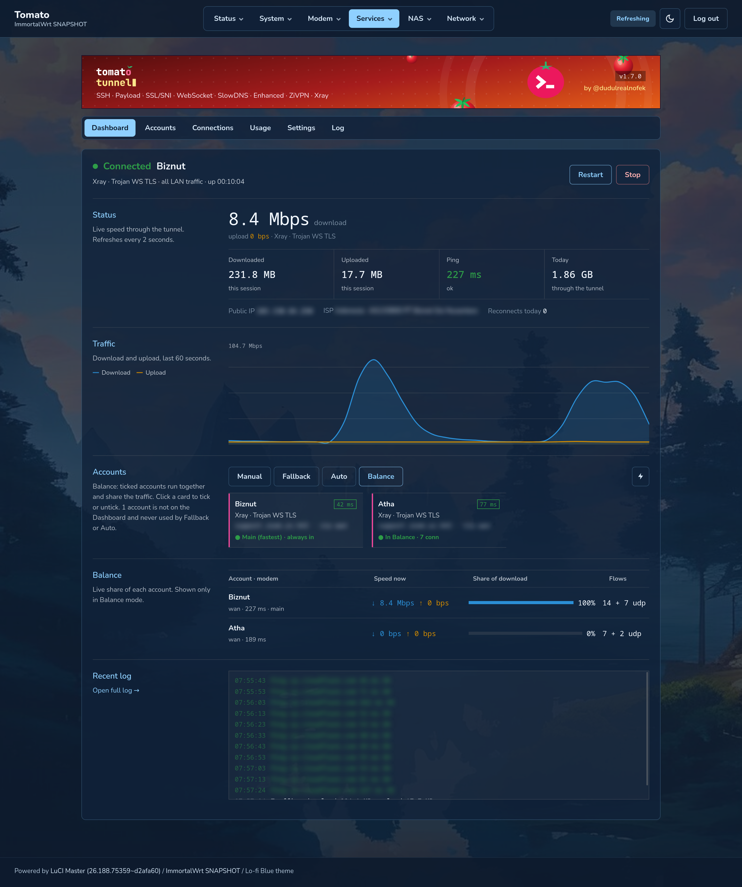
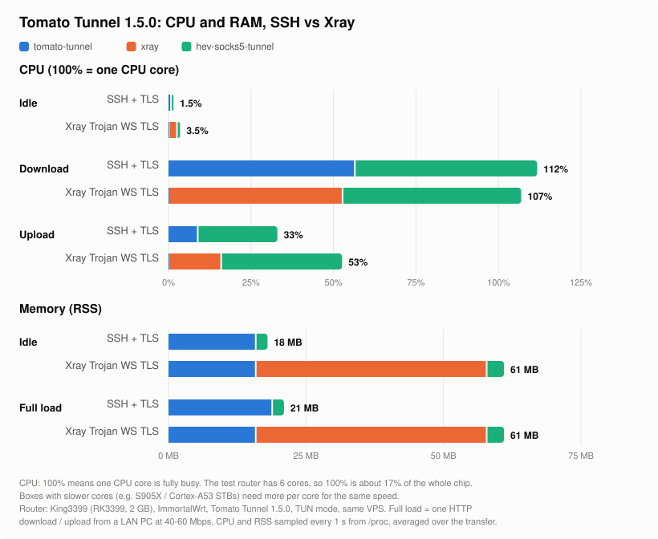

<p align="center">
  <picture>
    <source media="(prefers-color-scheme: dark)" srcset="docs/logo/lockup-dark.svg">
    
  </picture>
</p>

<p align="center">
  <a href="https://github.com/dudul19/luci-app-tomato-tunnel/releases/latest"></a>
  
  
</p>

# Tomato Tunnel

SSH, ZiVPN and Xray tunnel client for OpenWrt with a LuCI page. For SSH it works
like HTTP Custom: SSH is the base, and you add the layers you need on top of it.
ZiVPN works like the ZiVPN app: host, port and password only. Xray accounts
(VLESS, VMess, Trojan with WebSocket, HTTPUpgrade, gRPC, XHTTP, TLS or REALITY)
are imported by pasting the link.

**Guide:** [English](docs/GUIDE.md) · [Bahasa Indonesia](docs/GUIDE.id.md). Every
feature, setting and payload tag is explained there.

## Preview



Dashboard (v1.7.0 shown, same look in v1.7.5) on ImmortalWrt with the router's own LuCI theme, accounts in Balance. Public IP, ISP, domains and ports are blurred.

## Features

- **SSH**: Direct, Payload, Enhanced (split payload), TLS/SNI, WebSocket and
  SlowDNS, in any combination. Works with old Dropbear servers.
- **SlowDNS** with TXT, NULL, CNAME, HTTPS, SVCB, DNSKEY, A, AAAA, NS, MX or
  SRV records (Automatic tries each), also on DNS64 networks, and the
  operator's own DNS as resolver for networks that block public DNS.
- **ZiVPN** (host, port, password) and **Xray** (VLESS, VMess, Trojan over
  TCP, WebSocket, HTTPUpgrade, gRPC or XHTTP, with TLS or REALITY), imported
  from a link. Xray also runs over SlowDNS, or behind your own payload
  (Enhanced, inside or before TLS) with no change on the server.
- **TUN** (whole LAN, TCP and UDP), TCP redirect, or a SOCKS5 port for
  OpenClash and PassWall. DNS through the tunnel.
- **Dashboard** with live speed, traffic chart, ping and every profile.
  Switch profiles without Stop / Start. The page follows your LuCI theme.
- **Real ping**: each account logs in and opens the check URL through itself,
  so a dead or locked account shows failed. Unified delay like OpenClash.
- **Connections** tab: every connection with its device, site, account and
  speed, filtered per account with one click, one card per connection on a
  phone.
- **Profile selection**: Manual, Fallback (goes back to your chosen account
  once it works again), Auto (fastest) and **Balance**:
  several accounts at once, each on its own modem, so the speed of the modems
  adds up. Weight per account, UDP shared per flow, the account with the best
  ping becomes the main one by itself, and every Xray account shares one Xray
  process.
- **Change IP** for one or several modems: restart interface, AT command,
  ModemManager, HiLink / Orbit or an Android phone over ADB. Can keep trying
  until the IP is in your ranges (`10.0-10.19`, CIDR or prefix).
- **Usage** per day, account and device, with a quota warning. Account
  expiry reminders.
- **Schedule**: use another account or mode until a set time, or keep the
  tunnel off (or on only) in a time window, also after a reboot.
- **Tailscale** on the router goes through the tunnel, LAN devices reach
  100.x addresses, and LuCI opens over Tailscale from anywhere.
- **Telegram bot**: control, alerts and a daily report, English or Bahasa
  Indonesia.
- Indonesian IPs and chosen domains go direct for every account type, Block
  QUIC (Auto, for steadier YouTube), small ad block list (Xray).
- Updates from GitHub inside LuCI, checked with SHA256.

## Install

OpenWrt or ImmortalWrt 23.05 or newer. Download the file for your router from
the [Releases](https://github.com/dudul19/luci-app-tomato-tunnel/releases/latest) page,
copy it to `/tmp` and install it:

```sh
apk add --allow-untrusted /tmp/luci-app-tomato-tunnel_1.7.5_aarch64_generic.apk   # OpenWrt 25.x and newer
opkg install /tmp/luci-app-tomato-tunnel_1.7.5_aarch64_generic.ipk                # OpenWrt 23.05 and 24.10
```

Then open LuCI › Services › Tomato Tunnel. Xray accounts need the Xray add-on:
Settings › About & update › Install Xray. Architectures, requirements and the
full setup are in the [guide](docs/GUIDE.md#2-requirements).

## Performance



Measured on a King3399 (RK3399, 6 cores, 2 GB), ImmortalWrt, TUN mode. 100%
means one CPU core. Idle, everything together uses under 2% of one core.
Balance mode costs more CPU because all traffic passes through
`tomato-tunnel` to be shared; numbers in the [guide](docs/GUIDE.md#17-cpu-and-ram).

## Build

```sh
APK=/path/to/apk scripts/build.sh
```

Output goes to `dist/`. The version comes from the `VERSION` file and the
package release from `REL` in `scripts/build.sh`. A dev version
(`1.7.5-dev`) becomes `1.7.5_pre` (apk) / `1.7.5~dev` (ipk), so the final
`1.7.5` installs over it. The `apk` tool (apk-tools 3) comes with any OpenWrt 25.x
SDK or ImageBuilder in `staging_dir/host/bin/apk`. You also need Go 1.27 or
newer, `git`, `fakeroot` and `unshare`. The build works in `$TMPDIR`; point it
at a disk folder (`TMPDIR=~/.cache/tt-build`) when `/tmp` is a small tmpfs.
`ARCHS="aarch64_generic"` builds one architecture only.

SlowDNS uses kcp-go v5.6.8 from `third_party/kcp-go` (through a `replace` in
`go.mod`) with one addition: ACKs can be held for a few milliseconds and sent
together, which A/AAAA accounts use so the carrier DNS is not flooded with
ACK-only queries.

The Xray add-on is built from Xray-core v26.11.9 (cloned into
`third_party/xray-src/core`) with `third_party/xray-src/tomato.patch` (newer
dependencies, `allowInsecure` kept) and a client-only main in
`third_party/xray-src/ttxray`. Set `WITH_XRAY=0` to skip it.

## Release

Tag the version as `vX.Y.Z`, create a release and upload all files from `dist/`:

```
luci-app-tomato-tunnel_<version>_<arch>.apk
luci-app-tomato-tunnel_<version>_<arch>.ipk
tomato-tunnel-xray_<xray version>_<arch>.apk
tomato-tunnel-xray_<xray version>_<arch>.ipk
sha256sums.txt
```

The updater picks the file for the router's package manager and architecture,
and refuses to install it if the SHA256 does not match. Pre-releases are only
offered on the Beta channel.

## Source layout

| Path | Contents |
|---|---|
| `cmd/tomato-tunnel` | daemon and command line (`run`, `test`, `update`, `bot`) |
| `internal/tunnel` | payload, TLS, SlowDNS, SSH, ZiVPN, Xray (with its payload injector) and session pool |
| `internal/slowdns` | DNS transport: queries, polling and every record type (A/AAAA, DNS64) |
| `internal/proxy` | SOCKS5 with UDP over UDPGW, transparent redirect, DNS forwarder |
| `internal/daemon` | reconnect, ping check, live profile switch, latency test, Balance and status |
| `internal/usage` | daily, per-account and per-device traffic statistics |
| `internal/changeip` | Change IP methods (interface, AT, ModemManager, HiLink, ADB), IP ranges |
| `internal/bot` | Telegram bot: menus, alerts, daily report, pairing |
| `root/` | OpenWrt files: init script, network script, LuCI page |
| `third_party/` | kcp-go with ACK hold, Hysteria core for ZiVPN, hev-socks5-tunnel, Xray add-on sources |

## Credits

Made by [@dudulrealnofek](https://t.me/dudulrealnofek). Group: [@tfnuklir](https://t.me/tfnuklir).

Thanks to:

- [wegare](https://github.com/wegare123/stl) for stl, the SSH injector for OpenWrt that started the idea
- [heiher](https://github.com/heiher/hev-socks5-tunnel) for hev-socks5-tunnel
- [David Fifield](https://www.bamsoftware.com/software/dnstt/) for dnstt (SlowDNS)
- [Hysteria](https://github.com/apernet/hysteria) (apernet, MIT) for the QUIC core behind ZiVPN, in `third_party/hysteria-core`
- [Xray-core](https://github.com/XTLS/Xray-core) (XTLS, MPL-2.0) for the Xray add-on
- The Go team for golang.org/x/crypto/ssh
- OpenWrt and ImmortalWrt
- ePro Dev. Team, makers of HTTP Custom, for the payload modes

## License

GPL-3.0. The Xray add-on package contains Xray-core, MPL-2.0.
