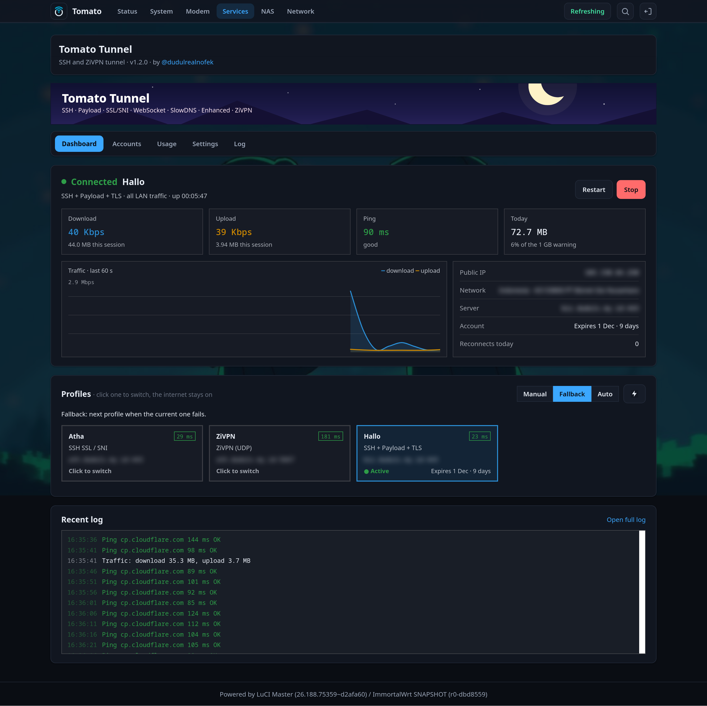

<p align="center">
  <picture>
    <source media="(prefers-color-scheme: dark)" srcset="docs/logo/lockup-dark.svg">
    
  </picture>
</p>

<p align="center">
  <a href="https://github.com/dudul19/tomato-tunnel/releases/latest"></a>
  
  
</p>

# Tomato Tunnel

SSH, ZiVPN and Xray tunnel client for OpenWrt with a LuCI page. For SSH it works
like HTTP Custom: SSH is the base, and you add the layers you need on top of it.
ZiVPN works like the ZiVPN app: host, port and password only. Xray accounts
(VLESS, VMess, Trojan with WebSocket, HTTPUpgrade, gRPC, XHTTP, TLS or REALITY)
are imported by pasting the link.

## Preview



Dashboard of v1.2.0 on ImmortalWrt with the Footstrap theme. Public IP, ISP and server domains are blurred.

## Connection types

| Connection | What it does |
|---|---|
| SSH Direct | Plain SSH to the server |
| SSH + Payload | Sends an HTTP payload first (WebSocket, CONNECT, ...) |
| SSH + Payload + Enhanced | Sends the payload in parts at every `[split]` |
| SSH + TLS | TLS with a custom SNI, then SSH |
| SSH + Payload + TLS | TLS with SNI, then the payload, then SSH |
| SSH + Payload + TLS + Enhanced | Same, with the payload split |
| SSH + SlowDNS | SSH carried over DNS (dnstt) |
| SSH + Payload + SlowDNS | Payload sent through the SlowDNS stream |
| ZiVPN | ZiVPN app protocol (Hysteria2 over QUIC). Carries TCP and UDP, only host, port and password needed |
| Xray | VLESS, VMess or Trojan over TCP, WebSocket, HTTPUpgrade, gRPC or XHTTP, with TLS or REALITY (Vision too). TCP and UDP. Needs the Xray add-on |

Any other combination can be set with "Custom combination" in the account form.

Other features:

- Allow insecure option for TLS (on by default, needed for most SNI hosts). Also
  for Xray: the bundled Xray build keeps `allowInsecure`, which upstream removed.
- Xray accounts: paste a `vless://`, `vmess://` or `trojan://` link and every
  field is filled in. The Xray add-on installs from a button in LuCI.
- Works with old Dropbear servers. SSH compatibility Auto tries modern
  algorithms first and falls back to diffie-hellman-group1/14-sha1, ssh-rsa,
  aes128-cbc and 3des-cbc. Legacy and Modern only are also available.
- Every HTTP reply from the front server is skipped until the SSH server answers.
- Shows the server banner in the log during login.
- Routes the whole LAN through the tunnel (TUN, TCP and UDP), or only TCP
  (redirect), or just opens a SOCKS5 port for OpenClash or PassWall.
- DNS through the tunnel. dnsmasq is pointed at it while connected and
  restored when you stop.
- Dashboard with live download/upload speed, a 60-second traffic chart, ping,
  public IP and every profile with its latency.
- Switch profiles from the Dashboard without Stop and Start. The current tunnel
  keeps working until the new profile is connected; if it fails, nothing changes.
- Profile selection: Manual, Fallback (next profile after 3 failed reconnects)
  or Auto (moves to a profile at least 20 ms faster, pinged every 5 minutes).
- Latency test like OpenClash: TCP ping to the server (or remote proxy) port,
  or one DNS query through the resolver for SlowDNS. No SSH login needed.
- Ping check and auto reconnect.
- Show on Dashboard per account: accounts you hide stay in the list as spares and
  are never used by Fallback or Auto.
- Indonesian IPs go direct (optional, every account type): local sites and games
  skip the tunnel. Uses the APNIC list for Indonesia in an nftables set.
- For Xray accounts: domains that always go direct (for example bank apps) and a
  small built-in ad and tracker block list.
- Change IP: restart the interface, airplane mode by AT command, ModemManager,
  HiLink / Orbit modem or an Android phone over ADB. After failed connects, on a
  schedule or from a button on the Dashboard. Can keep trying until the IP starts
  with a prefix you choose.
- Usage tab: traffic per day, per account and per device (TUN mode), monthly
  totals, a quota warning and the day your package renews.
- Expiry date per account: a reminder before it ends, and expired accounts are
  skipped by Auto and Fallback.
- Paste an account message to import it, share one account as a link, or back up
  and restore every account as a JSON file.
- Reorder accounts by dragging them, delete them straight from the list.
- Six built-in banners (Tomato is the default) or your own image.
- 1 to 4 parallel SSH sessions.
- Updates from GitHub Releases inside LuCI, checked with SHA256. Settings are kept.
- Uses the standard LuCI layout, so it follows any theme.

## Requirements

- OpenWrt or ImmortalWrt 23.05 or newer on one of these architectures:

| Architecture | Typical devices |
|---|---|
| `aarch64_generic` | Amlogic / Rockchip STBs and boards, most 64-bit ARM |
| `aarch64_cortex-a53` | Raspberry Pi 3/4 (64-bit), MediaTek Filogic MT7981/MT7986 |
| `aarch64_cortex-a72` | Raspberry Pi 4 (bcm2711), NanoPi R4S |
| `arm_cortex-a7`, `arm_cortex-a7_neon-vfpv4` | Allwinner H3, Qualcomm IPQ40xx |
| `arm_cortex-a9`, `arm_cortex-a9_vfpv3-d16` | Marvell mvebu (Linksys WRT) |
| `arm_cortex-a15_neon-vfpv4` | Qualcomm IPQ806x |
| `mipsel_24kc` | MediaTek MT7621 / MT7628 |
| `mips_24kc` | Atheros / QCA ath79 |
| `x86_64` | PCs, mini PCs, virtual machines |

- About 13 MB of free flash and 64 MB of free RAM. Routers with 16 MB of flash
  are too small unless they use extroot or USB storage. Only aarch64 has been
  tested on a real router so far.
- The Xray add-on needs about 30 MB more flash (11 MB download). It is optional;
  without it everything except Xray accounts works.
- These packages, installed automatically from the official repo:
  `kmod-tun ip-full ca-bundle luci-base`
- hev-socks5-tunnel 2.17.1 (static, MIT) is bundled in the package, so it also
  installs on OpenWrt 23.05 where that package is not in the feed

## Install

Download the file for your router from the Releases page and copy it to `/tmp`.

OpenWrt 25.x and newer (apk):

```sh
cat /etc/apk/arch
apk update
apk add --allow-untrusted /tmp/luci-app-tomato-tunnel_1.3.1_aarch64_generic.apk
```

OpenWrt 23.05 and 24.10 (opkg):

```sh
opkg print-architecture
opkg update
opkg install /tmp/luci-app-tomato-tunnel_1.3.1_aarch64_generic.ipk
```

Open LuCI, go to Services > Tomato Tunnel, add or import an account and press
Save & Apply. The tunnel starts right away.

### Xray add-on

Only needed for Xray accounts. The easiest way: Settings > About & update >
Xray add-on > Install Xray (or the Install Xray button in an Xray account). It
downloads the right package from the latest release and checks the SHA256.

By hand, copy `tomato-tunnel-xray_<version>_<arch>` to `/tmp` and run:

```sh
apk add --allow-untrusted /tmp/tomato-tunnel-xray_26.11.9_aarch64_generic.apk   # apk
opkg install /tmp/tomato-tunnel-xray_26.11.9_aarch64_generic.ipk                # opkg
```

When Tomato Tunnel updates itself, the add-on is updated too.

If you also use OpenClash or PassWall, do not run both in TUN mode at the same
time. Set Tomato Tunnel to SOCKS5 only and use `127.0.0.1:1080` as a proxy there.

## Payload tags

`[bug]` `[host]` `[port]` `[host_port]` `[ssh]` `[ua]` `[crlf]` `[crlf*2]` `[cr]` `[lf]`
`[lfcr]` `[protocol]` `[method]` `[raw]` `[netData]` `[auth]`

Splits:

- `[split]` new write after the split delay set in the account (default 1000 ms)
- `[delay_split]` new write after 1.5 s
- `[instant_split]` new write with no delay

Example:

```
HEAD / HTTP/1.1[crlf]Host: [bug][crlf][crlf]PATCH / HTTP/1.1[crlf]Host: [host][crlf]Upgrade: websocket[crlf][crlf][split]HTTP/1.1[crlf][crlf]
```

## Build

```sh
APK=/path/to/apk scripts/build.sh
```

Output goes to `dist/`. The `apk` tool (apk-tools 3) comes with any OpenWrt 25.x
SDK or ImageBuilder in `staging_dir/host/bin/apk`. You also need Go 1.27 or
newer, `git`, `fakeroot` and `unshare`.

The Xray add-on is built from Xray-core v26.11.9 (cloned into
`third_party/xray-src/core`) with `third_party/xray-src/tomato.patch` (newer
dependencies, `allowInsecure` kept) and a client-only main in
`third_party/xray-src/ttxray`. Set `WITH_XRAY=0` to skip it.

## Release

Tag the version as `vX.Y.Z`, create a release and upload all files from `dist/`:

```
luci-app-tomato-tunnel_<version>_<arch>.apk
luci-app-tomato-tunnel_<version>_<arch>.ipk
tomato-tunnel-xray_<xray version>_<arch>.apk
tomato-tunnel-xray_<xray version>_<arch>.ipk
sha256sums.txt
```

The updater picks the file for the router's package manager and architecture,
and refuses to install it if the SHA256 does not match. Pre-releases are only
offered on the Beta channel.

## Source layout

| Path | Contents |
|---|---|
| `cmd/tomato-tunnel` | daemon and command line (`run`, `test`, `update`) |
| `internal/tunnel` | payload, TLS, SlowDNS, SSH, ZiVPN, Xray and session pool |
| `internal/proxy` | SOCKS5 with UDP over UDPGW, transparent redirect, DNS forwarder |
| `internal/daemon` | reconnect, ping check, live profile switch, latency test and status |
| `internal/usage` | daily, per-account and per-device traffic statistics |
| `internal/changeip` | Change IP methods (interface, AT, ModemManager, HiLink, ADB) |
| `root/` | OpenWrt files: init script, network script, LuCI page |

## Credits

Made by [@dudulrealnofek](https://t.me/dudulrealnofek). Group: [@tfnuklir](https://t.me/tfnuklir).

Thanks to:

- [wegare](https://github.com/wegare123/stl) for stl, the SSH injector for OpenWrt that started the idea
- [heiher](https://github.com/heiher/hev-socks5-tunnel) for hev-socks5-tunnel
- [David Fifield](https://www.bamsoftware.com/software/dnstt/) for dnstt (SlowDNS)
- [Hysteria](https://github.com/apernet/hysteria) (apernet, MIT) for the QUIC core behind ZiVPN, in `third_party/hysteria-core`
- [Xray-core](https://github.com/XTLS/Xray-core) (XTLS, MPL-2.0) for the Xray add-on
- The Go team for golang.org/x/crypto/ssh
- OpenWrt and ImmortalWrt
- HTTP Custom for the payload modes

## License

GPL-3.0. The Xray add-on package contains Xray-core, MPL-2.0.
