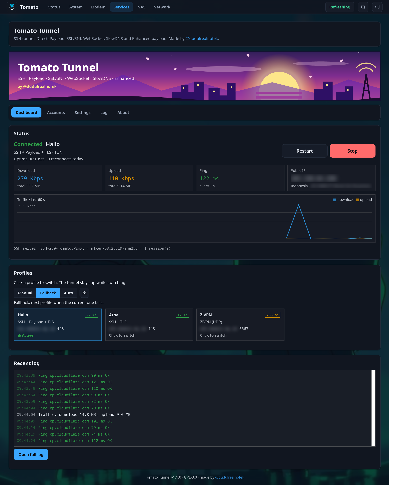

# Tomato Tunnel

SSH and ZiVPN tunnel client for OpenWrt with a LuCI page. For SSH it works like
HTTP Custom: SSH is the base, and you add the layers you need on top of it.
ZiVPN (UDP) works like the ZiVPN app: host, port and password only.

## Preview



Dashboard of v1.1.0 on ImmortalWrt with the Argon theme. Public IP, ISP and server domains are blurred.

## Connection types

| Connection | What it does |
|---|---|
| SSH Direct | Plain SSH to the server |
| SSH + Payload | Sends an HTTP payload first (WebSocket, CONNECT, ...) |
| SSH + Payload + Enhanced | Sends the payload in parts at every `[split]` |
| SSH + TLS | TLS with a custom SNI, then SSH |
| SSH + Payload + TLS | TLS with SNI, then the payload, then SSH |
| SSH + Payload + TLS + Enhanced | Same, with the payload split |
| SSH + SlowDNS | SSH carried over DNS (dnstt) |
| SSH + Payload + SlowDNS | Payload sent through the SlowDNS stream |
| ZiVPN (UDP) | ZiVPN app protocol (Hysteria2 over QUIC). Carries TCP and UDP, only host, port and password needed |

Any other combination can be set with "Custom combination" in the account form.

Other features:

- Allow insecure option for TLS (on by default, needed for most SNI hosts).
- Works with old Dropbear servers. SSH compatibility Auto tries modern
  algorithms first and falls back to diffie-hellman-group1/14-sha1, ssh-rsa,
  aes128-cbc and 3des-cbc. Legacy and Modern only are also available.
- Every HTTP reply from the front server is skipped until the SSH server answers.
- Shows the server banner in the log during login.
- Routes the whole LAN through the tunnel (TUN, TCP and UDP), or only TCP
  (redirect), or just opens a SOCKS5 port for OpenClash or PassWall.
- DNS through the tunnel. dnsmasq is pointed at it while connected and
  restored when you stop.
- Dashboard with live download/upload speed, a 60-second traffic chart, ping,
  public IP and every profile with its latency.
- Switch profiles from the Dashboard without Stop and Start. The current tunnel
  keeps working until the new profile is connected; if it fails, nothing changes.
- Profile selection: Manual, Fallback (next profile after 3 failed reconnects)
  or Auto (moves to a profile at least 20 ms faster, pinged every 5 minutes).
- Latency test like OpenClash: TCP ping to the server (or remote proxy) port,
  or one DNS query through the resolver for SlowDNS. No SSH login needed.
- Ping check, auto reconnect, optional modem restart.
- 1 to 4 parallel SSH sessions.
- Updates from GitHub Releases inside LuCI, checked with SHA256. Settings are kept.
- Uses the standard LuCI layout, so it follows any theme.

## Requirements

- aarch64 router (`aarch64_generic`, `aarch64_cortex-a53` or `aarch64_cortex-a72`)
- OpenWrt or ImmortalWrt 23.05 or newer
- These packages, installed automatically from the official repo:
  `kmod-tun ip-full ca-bundle luci-base`
- hev-socks5-tunnel 2.17.1 (static, MIT) is bundled in the package, so it also
  installs on OpenWrt 23.05 where that package is not in the feed

## Install

Download the file for your router from the Releases page and copy it to `/tmp`.

OpenWrt 25.x and newer (apk):

```sh
cat /etc/apk/arch
apk update
apk add --allow-untrusted /tmp/luci-app-tomato-tunnel_1.0.0_aarch64_generic.apk
```

OpenWrt 23.05 and 24.10 (opkg):

```sh
opkg print-architecture
opkg update
opkg install /tmp/luci-app-tomato-tunnel_1.0.0_aarch64_generic.ipk
```

Open LuCI, go to Services > Tomato Tunnel, add or import an account and press
Save & Apply. The tunnel starts right away.

If you also use OpenClash or PassWall, do not run both in TUN mode at the same
time. Set Tomato Tunnel to SOCKS5 only and use `127.0.0.1:1080` as a proxy there.

## Payload tags

`[bug]` `[host]` `[port]` `[host_port]` `[ssh]` `[ua]` `[crlf]` `[crlf*2]` `[cr]` `[lf]`
`[lfcr]` `[protocol]` `[method]` `[raw]` `[netData]` `[auth]`

Splits:

- `[split]` new write after the split delay set in the account (default 1000 ms)
- `[delay_split]` new write after 1.5 s
- `[instant_split]` new write with no delay

Example:

```
HEAD / HTTP/1.1[crlf]Host: [bug][crlf][crlf]PATCH / HTTP/1.1[crlf]Host: [host][crlf]Upgrade: websocket[crlf][crlf][split]HTTP/1.1[crlf][crlf]
```

## Build

```sh
APK=/path/to/apk scripts/build.sh
```

Output goes to `dist/`. The `apk` tool (apk-tools 3) comes with any OpenWrt 25.x
SDK or ImageBuilder in `staging_dir/host/bin/apk`. You also need Go 1.23 or
newer, `fakeroot` and `unshare`.

## Release

Tag the version as `vX.Y.Z`, create a release and upload all files from `dist/`:

```
luci-app-tomato-tunnel_<version>_<arch>.apk
luci-app-tomato-tunnel_<version>_<arch>.ipk
sha256sums.txt
```

The updater picks the file for the router's package manager and architecture,
and refuses to install it if the SHA256 does not match. Pre-releases are only
offered on the Beta channel.

## Source layout

| Path | Contents |
|---|---|
| `cmd/tomato-tunnel` | daemon and command line (`run`, `test`, `update`) |
| `internal/tunnel` | payload, TLS, SlowDNS, SSH and session pool |
| `internal/proxy` | SOCKS5 with UDP over UDPGW, transparent redirect, DNS forwarder |
| `internal/daemon` | reconnect, ping check, live profile switch, latency test and status |
| `root/` | OpenWrt files: init script, network script, LuCI page |

## Credits

Made by [@dudulrealnofek](https://t.me/dudulrealnofek). Group: [@tfnuklir](https://t.me/tfnuklir).

Thanks to:

- [wegare](https://github.com/wegare123/stl) for stl, the SSH injector for OpenWrt that started the idea
- [heiher](https://github.com/heiher/hev-socks5-tunnel) for hev-socks5-tunnel
- [David Fifield](https://www.bamsoftware.com/software/dnstt/) for dnstt (SlowDNS)
- [Hysteria](https://github.com/apernet/hysteria) (apernet, MIT) for the QUIC core behind ZiVPN, in `third_party/hysteria-core`
- The Go team for golang.org/x/crypto/ssh
- OpenWrt and ImmortalWrt
- HTTP Custom for the payload modes

## License

GPL-3.0
